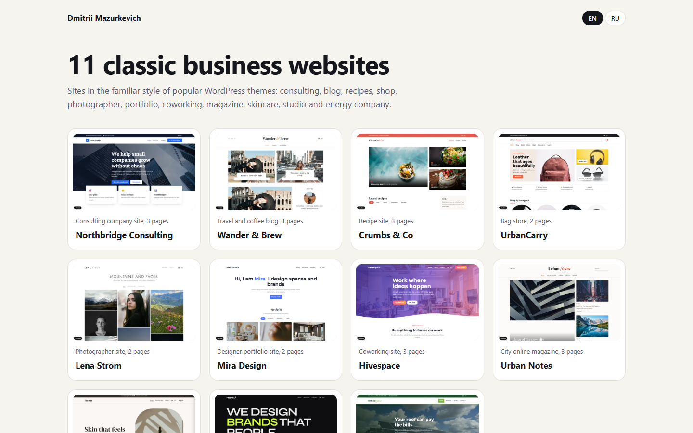

# 11 classic business websites

Sites in the familiar style of popular WordPress themes: consulting, blog, recipes, shop, photographer, portfolio, coworking, magazine, skincare, studio and energy company.

**Live:** https://dmitrii-mazurkevich.github.io/business-websites/

## Inside

- [Northbridge Consulting](https://dmitrii-mazurkevich.github.io/business-websites/business/index.html): consulting company site, 3 pages
- [Wander & Brew](https://dmitrii-mazurkevich.github.io/business-websites/blog/index.html): travel and coffee blog, 3 pages
- [Crumbs & Co](https://dmitrii-mazurkevich.github.io/business-websites/recipes/index.html): recipe site, 3 pages
- [UrbanCarry](https://dmitrii-mazurkevich.github.io/business-websites/shop/index.html): bag store, 2 pages
- [Lena Strom](https://dmitrii-mazurkevich.github.io/business-websites/photo/index.html): photographer site, 2 pages
- [Mira Design](https://dmitrii-mazurkevich.github.io/business-websites/portfolio/index.html): designer portfolio site, 2 pages
- [Hivespace](https://dmitrii-mazurkevich.github.io/business-websites/cowork/index.html): coworking site, 3 pages
- [Urban Notes](https://dmitrii-mazurkevich.github.io/business-websites/magazine/index.html): city online magazine, 3 pages
- [Lumen](https://dmitrii-mazurkevich.github.io/business-websites/skincare/index.html): skincare store, 3 pages
- [Studio Nord](https://dmitrii-mazurkevich.github.io/business-websites/studio/index.html): design studio site, 2 pages
- [Helio Energy](https://dmitrii-mazurkevich.github.io/business-websites/energy/index.html): solar energy company site, 3 pages

## Built with

HTML, CSS, JavaScript. Static site without a build step: open `index.html` or publish the folder to any hosting.
English and Russian versions with a language switcher, layout for phones and desktops.

## Author

Made by Dmitrii Mazurkevich: websites, WordPress and WooCommerce, analytics and AI automation.
Telegram https://t.me/dmitrii_pjm · dmitrymazurkevichse@gmail.com · [all works](https://dmitriiwebcraft.com)
